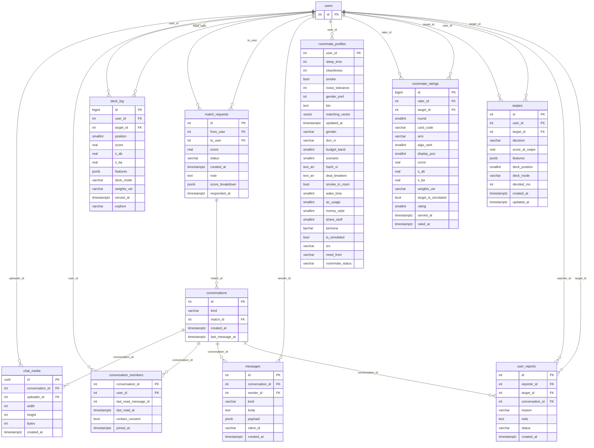
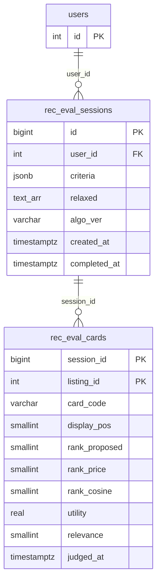
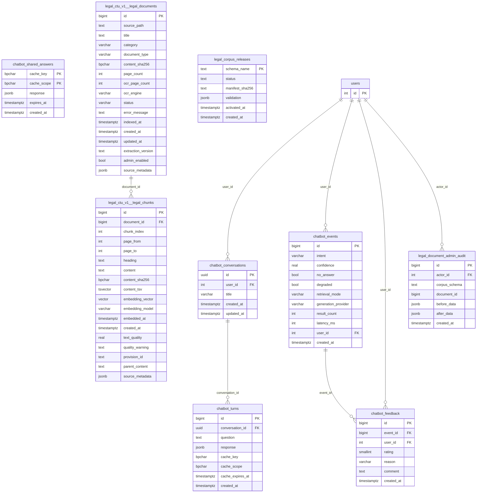

# ERD — sinh tự động từ schema đang chạy

> Sinh ngày 14/10/2026 từ `information_schema` của DB dev (đủ migration `infra/db/migrations/20–102`). Đây là **nguồn
> đúng** để vẽ ERD; thư mục `Diagrams/` (08/2026) đã cũ. Bảng thuộc nhóm khác chỉ hiện khoá để nối quan hệ.
> Kiểu `geometry` = PostGIS (toạ độ), `vector` = pgvector (embedding), `*_arr` = mảng Postgres. Cột chi tiết + ý nghĩa:
> `docs/reference/Data_Dictionary.md` (một phần) và các file migration.

## 1. Tin trọ, dữ liệu thu thập, bản đồ, đánh giá

```mermaid
erDiagram
    aggregated_listings {
        int id PK
        text title
        int price
        real area
        text address
        varchar district
        geometry geom
        text_arr images
        text description
        varchar source
        text source_url
        varchar source_id
        bpchar content_hash
        bytea minhash
        jsonb parsed_amenities
        real risk_score
        text_arr risk_reasons
        real distance_to_ctu
        varchar geocode_confidence
        vector embedding_vector
        listing_status status
        timestamptz first_seen
        timestamptz last_seen
        int miss_count
        real freshness_score
        timestamptz updated_at
        int posted_by FK
        real_arr route_time_campus
        cleaning_status_type cleaning_status
        bool is_imputed_area
        text cleaning_logs
        listing_type_enum listing_type
        real quality_score
        int electricity_price
        int water_price
        varchar water_unit
        bool utility_state_price
        int deposit_amount
        real deposit_months
        varchar gender_only
        smallint curfew_hour
        bool free_hours
        timestamptz extras_extracted_at
        varchar contact_phone
        varchar contact_phone_alt
        varchar contact_zalo
        varchar contact_name
        text contact_facebook
        varchar contact_source
        timestamptz contact_extracted_at
        text address_full
        text street
        varchar ward
        varchar district_norm
        varchar address_confidence
        varchar address_source
        timestamptz address_normalized_at
        varchar offer_kind
        text audit_reason
        timestamptz audit_at
        bool location_precise
        varchar embedding_model
        bpchar embedded_content_hash
        timestamptz embedded_at
        timestamptz risk_evaluated_at
    }
    crawl_runs {
        int id PK
        varchar source
        varchar mode
        timestamptz started_at
        timestamptz finished_at
        int fetched
        int new_count
        int updated_count
        int expired_count
        text error
    }
    pois {
        int id PK
        varchar osm_type
        bigint osm_id
        varchar category
        text name
        geometry geom
        jsonb tags
        timestamptz fetched_at
    }
    route_cache {
        numeric origin_lat PK
        numeric origin_lng PK
        smallint campus PK
        varchar profile PK
        jsonb path
        timestamptz fetched_at
    }
    places {
        int id PK
        varchar provider
        text provider_place_id
        text name
        text address
        geometry geom
        real rating
        int rating_count
        text maps_uri
        varchar primary_type
        int listing_id FK
        real match_distance_m
        timestamptz fetched_at
        varchar phone
        varchar phone_intl
        text website
        varchar business_status
        text_arr opening_hours
        varchar ward
        varchar district_norm
    }
    place_reviews {
        int id PK
        int place_id FK
        text provider_review_id
        smallint rating
        text text
        varchar language
        text author_name
        timestamptz published_at
        text relative_time
        varchar sentiment
        timestamptz fetched_at
    }
    reviews {
        int id PK
        int listing_id FK
        int place_id FK
        int user_id FK
        smallint rating
        text_arr tags
        text content
        varchar stay_period
        varchar status
        timestamptz created_at
        timestamptz updated_at
    }
    reports {
        int id PK
        int listing_id FK
        int reporter_id FK
        varchar reason
        text note
        varchar status
        timestamptz created_at
    }
    user_interactions {
        int id PK
        int user_id FK
        int listing_id FK
        varchar type
        int duration_ms
        timestamptz created_at
    }
    saved_searches {
        int id PK
        int user_id FK
        jsonb criteria
        timestamptz created_at
    }
    users {
        int id PK
    }
    users ||--o{ aggregated_listings : "posted_by"
    places ||--o{ place_reviews : "place_id"
    aggregated_listings ||--o{ places : "listing_id"
    aggregated_listings ||--o{ reports : "listing_id"
    users ||--o{ reports : "reporter_id"
    aggregated_listings ||--o{ reviews : "listing_id"
    places ||--o{ reviews : "place_id"
    users ||--o{ reviews : "user_id"
    users ||--o{ saved_searches : "user_id"
    users ||--o{ user_interactions : "user_id"
    aggregated_listings ||--o{ user_interactions : "listing_id"
```

## 2. Người dùng & xác thực

```mermaid
erDiagram
    users {
        int id PK
        varchar email
        text password_hash
        varchar name
        text avatar_url
        varchar phone
        varchar role
        vector preference_vector
        bool email_verified
        timestamptz created_at
        timestamptz last_seen_at
        timestamptz locked_at
    }
    user_identities {
        int id PK
        int user_id FK
        varchar provider
        varchar provider_user_id
        text secret_hash
        timestamptz created_at
    }
    aggregated_listings {
        int id PK
    }
    chat_media {
        uuid id PK
    }
    chatbot_conversations {
        uuid id PK
    }
    chatbot_events {
        bigint id PK
    }
    chatbot_feedback {
        bigint id PK
    }
    conversation_members {
        int conversation_id PK
        int user_id PK
    }
    deck_log {
        bigint id PK
    }
    legal_document_admin_audit {
        bigint id PK
    }
    match_requests {
        int id PK
    }
    messages {
        int id PK
    }
    rec_eval_sessions {
        bigint id PK
    }
    reports {
        int id PK
    }
    reviews {
        int id PK
    }
    roommate_profiles {
        int user_id PK
    }
    roommate_ratings {
        bigint id PK
    }
    saved_searches {
        int id PK
    }
    swipes {
        int id PK
    }
    user_interactions {
        int id PK
    }
    user_reports {
        int id PK
    }
    users ||--o{ aggregated_listings : "posted_by"
    users ||--o{ chat_media : "uploader_id"
    users ||--o{ chatbot_conversations : "user_id"
    users ||--o{ chatbot_events : "user_id"
    users ||--o{ chatbot_feedback : "user_id"
    users ||--o{ conversation_members : "user_id"
    users ||--o{ deck_log : "user_id"
    users ||--o{ deck_log : "target_id"
    users ||--o{ legal_document_admin_audit : "actor_id"
    users ||--o{ match_requests : "from_user"
    users ||--o{ match_requests : "to_user"
    users ||--o{ messages : "sender_id"
    users ||--o{ rec_eval_sessions : "user_id"
    users ||--o{ reports : "reporter_id"
    users ||--o{ reviews : "user_id"
    users ||--o{ roommate_profiles : "user_id"
    users ||--o{ roommate_ratings : "rater_id"
    users ||--o{ roommate_ratings : "target_id"
    users ||--o{ saved_searches : "user_id"
    users ||--o{ swipes : "user_id"
    users ||--o{ swipes : "target_id"
    users ||--o{ user_identities : "user_id"
    users ||--o{ user_interactions : "user_id"
    users ||--o{ user_reports : "reporter_id"
    users ||--o{ user_reports : "target_id"
```

## 3. Ghép bạn ở & chat realtime

## 4. Gợi ý nhà trọ — phiếu đánh giá mù

## 5. Trợ lý AI (chatbot) & kho tài liệu

