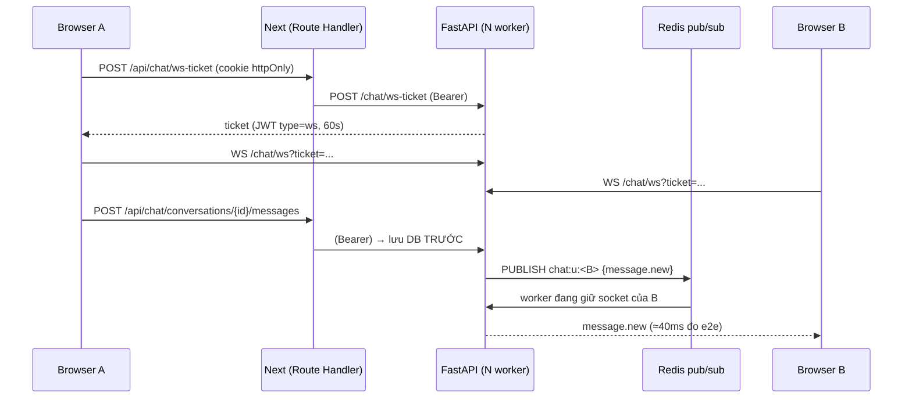

# Chat realtime giữa SV đã ghép ở — kỹ thuật

_Lập: 01/10/2026 · Mockup: `UI_NCKH.html` màn 06 · Thiết kế gốc: `Matching_Messaging_Design.md` Phần I_

> Khác thiết kế 26/09 ở **một điểm**: kênh đẩy dùng **WebSocket** (không còn polling-only).
> Polling 3s vẫn còn nhưng chỉ là **đường dự phòng** khi socket rớt — xem ADR-012.

## 1. Luồng tổng quát



- **Ghi luôn qua REST, đẩy qua WS.** Tin nằm ở DB trước khi publish ⇒ socket rớt không mất tin; FE nối lại thì gọi `?after_id=` để bù.
- **Vé WS**: browser không gắn được header vào WebSocket, token lại nằm trong cookie httpOnly của Next (khác origin API) ⇒ xin vé 60s qua Route Handler. Vé có `type=ws`, access token không dùng thay được (test `test_websocket_bad_ticket_closed_4401`).
- **Nhiều worker**: mỗi process `psubscribe chat:u:*` trong 1 thread nền; envelope có `origin` để không giao trùng. **Redis chết ⇒ tự về chế độ 1 process** (giao tại chỗ), thử nối lại sau 30s. *Đã kiểm bằng `tests/test_chat_hub.py` (06/10): hai ChatHub độc lập (= hai worker) qua Redis thật — sự kiện tới socket ở hub kia, không giao trùng; Redis không tới được ⇒ publish không lỗi, socket cùng process vẫn nhận, không thử nối lại trong khoảng chờ; hết khoảng chờ thì nối lại. Kết nối Redis + psubscribe nằm trong lock riêng (bản trước có thể psubscribe 2 lần ⇒ tin hiện đôi). Envelope hỏng (không phải JSON/dict, thiếu `text`) bị bỏ qua thay vì giết thread pubsub.*
- **Fallback FE**: `status !== "open"` ⇒ poll tin mới 3s/lần + danh sách hội thoại 9s/lần, hiện banner vàng "Mất kết nối realtime". Gửi tin vẫn chạy (REST).

## 2. Sự kiện WebSocket

| Hướng | type | Nội dung |
|---|---|---|
| S→C | `hello` | `online: [user_id đang online trong số người đã ghép]` |
| S→C | `message.new` | `conversation_id`, `message` (cả người gửi cũng nhận — đồng bộ nhiều tab) |
| S→C | `read` | `user_id`, `message_id` — con trỏ đã xem mới |
| S→C | `typing` | `user_id`, `is_typing` (FE tự tắt sau 6s) |
| S→C | `presence` | `online`, `last_seen_at` khi offline |
| S→C | `match.new` / `like.new` | tải lại danh sách / tab Lời mời |
| S→C | `conversation.removed` | bên kia huỷ ghép (hoặc "bỏ qua" người đang ghép ở `/roommate`) |
| S→C | `contact.consent` | `user_id`, `unlocked` — chỉ là tín hiệu "bên kia vừa đồng ý T3", **không** mang email/SĐT |
| C→S | `ping` (25s) → `pong` | giữ presence (TTL Redis 90s) |
| C→S | `typing` | server kiểm tra thành viên rồi mới chuyển tiếp (cache thành viên 30s — mỗi phím gõ không còn tốn 1 kết nối DB) |

Vé sai/hết hạn ⇒ server từ chối **ngay ở bắt tay** (chưa `accept`, trình duyệt thấy lỗi kết nối; TestClient thấy mã 4401). Quá **5 socket/user** ⇒ đóng `4429`. FE không dựa vào mã đóng: mỗi lần nối lại đều xin vé mới (backoff 1-2-4-8-15s).

## 3. REST

| Method | Path | Ghi chú |
|---|---|---|
| POST | `/matching/swipe` | `{target_id, decision: like\|pass}` → `{matched, conversation_id}`; thích 2 chiều ⇒ tạo match + hội thoại trong **cùng transaction** (advisory lock theo cặp — 2 người bấm cùng lúc vẫn ra 1 hội thoại) |
| GET | `/matching/likes` | tab **Lời mời**: ai đã thích mình mà mình chưa quyết |
| POST | `/chat/ws-ticket` | vé 60s |
| GET | `/chat/unread` | `{messages, likes}` cho badge header |
| GET | `/chat/conversations` | kèm `unread`, `partner.online`, `partner_last_read`; phân trang keyset `?limit=50&before=&before_id=` → `{items, has_more, next}` |
| GET | `/chat/conversations/{id}` | + `partner_profile` (T1, không email/SĐT/MSSV) + `shared_listings` |
| GET | `/chat/conversations/{id}/messages` | `after_id` (đồng bộ) · `before_id` (tin cũ hơn) · `limit` |
| POST | `/chat/conversations/{id}/messages` | `{kind: text\|listing, body?, listing_id?, client_id}` — tin trọ chụp snapshot **phía server** |
| POST | `/chat/conversations/{id}/images` | multipart `files[]` (≤4, ≤8MB/ảnh) |
| GET | `/chat/media/{id}` | chỉ thành viên hội thoại tải được |
| POST | `/chat/conversations/{id}/read` | `{message_id}` — không lùi, không vượt tin cuối |
| DELETE | `/chat/conversations/{id}` | huỷ ghép: xoá **cứng** tin + ảnh cả 2 phía; swipe về `pass` để không tự ghép lại |
| POST | `/chat/conversations/{id}/report` | `{reason, note}` → bảng `user_reports` |
| GET/POST | `/chat/conversations/{id}/contact-consent` | **T3**: đồng ý cho người kia xem liên hệ của MÌNH; email/SĐT/Zalo chỉ trả khi **mọi** thành viên đã đồng ý — điều kiện nằm trong WHERE của SQL (`_CONTACT_SQL`), không ở Python. Đồng ý là một chiều (chưa có rút lại) |

Rate limit (429 + `Retry-After`, `app/ratelimit.py`, theo user, trong bộ nhớ worker): tin 30/phút · upload 10/phút · báo cáo 5/10 phút. Body upload > 4 × 8 MB (+256 KB) ⇒ **413** ở middleware ASGI, trước khi Starlette spool xuống đĩa. Hội thoại bị huỷ giữa lúc kiểm quyền và lúc ghi ⇒ 404 (khoá dòng member trong transaction), không 500. Đối phương xoá tài khoản ⇒ mọi endpoint của hội thoại đó 404.

Người không phải thành viên luôn nhận **404** (không lộ hội thoại nào tồn tại). `client_id` làm idempotency: mạng chập chờn gửi lại không ra tin đôi.

## 4. Dữ liệu — `infra/db/migrations/92_matching_chat.sql`

`swipes` · `conversations` (+`last_message_at`) · `conversation_members` (`last_read_message_id` → "Đã xem" + đếm chưa đọc) · `messages` (`kind`, `payload JSONB`, `client_id`) · `chat_media` · `user_reports` · `users.last_seen_at` · cột form v2 cho `roommate_profiles` (theo thiết kế 2.9). Migration idempotent — apply tay vào DB đang chạy được.

## 5. Ảnh

Re-encode JPEG ≤1600px, **xoá toàn bộ EXIF (kể cả GPS)** — ảnh chụp phòng bằng điện thoại thường kèm toạ độ nhà người gửi. File giả đuôi bị từ chối (decode thất bại). Lưu ở volume docker `media` (`/app/media/chat/<uuid>.jpg`), tải qua `/api/chat/media/{id}` (proxy Next gắn token) — không có URL public.

## 6. Frontend — `apps/web/src/app/chat/`

| File | Vai trò |
|---|---|
| `page.tsx` | server: lấy user; cookie có mà không dùng được ⇒ `/login?reauth=1&next=/chat` (middleware xoá cookie — hết vòng redirect vô hạn) |
| `ChatApp.tsx` | state + xử lý sự kiện + optimistic send + fallback polling + đánh dấu đã xem |
| `ConversationList.tsx` | tìm kiếm, tab **Đã ghép** (dải "Mới ghép" kiểu Tinder + danh sách) / **Lời mời** (Thích lại / Bỏ qua) |
| `ChatThread.tsx` | header online/đang nhập, tin nhắn nhóm theo người + ngày, tải tin cũ, composer (Enter gửi, Shift+Enter xuống dòng), gợi ý nhanh |
| `MessageItem.tsx` | bong bóng text / lưới ảnh / thẻ tin trọ / tin hệ thống; "Đã gửi · Đã xem", "Gửi lỗi · Thử lại" |
| `ProfilePanel.tsx` | hồ sơ ở ghép, tin đã chia sẻ, nhắc an toàn, ghi chú lưu trữ dữ liệu, Báo cáo / Huỷ ghép |
| `Modals.tsx` | Thành đôi!, chọn tin trọ, báo cáo, xác nhận huỷ ghép, xem ảnh |
| `lib/chat/useChatSocket.ts` | 1 socket/trang, vé, ping, backoff, nối lại khi tab hiện lại / có mạng |
| `lib/proxy.ts` | proxy Route Handler → API, **tự refresh token** (chat mở cả buổi > 15 phút) |
| `ChatNavLink.tsx` | "Tin nhắn" + badge chưa đọc trên header |

Mobile (<768px): danh sách ↔ khung chat một màn, nút quay lại; hồ sơ mở dạng ngăn kéo (<1280px).

## 7. Kiểm thử

- `apps/api/tests/test_chat.py` — 14 test, DB + Redis thật: match 1 chiều/2 chiều, đồng thời, quyền thành viên, idempotent, chưa đọc/đã xem, snapshot tin trọ, EXIF/resize/riêng tư ảnh, huỷ ghép xoá file, báo cáo, WS (vé sai, tin/typing/đã xem/presence, match.new). Chạy cả khi **Redis tắt** (local-only).
- `tests/test_chat_t3.py` — T3 lộ liên hệ hai chiều. `tests/test_chat_hardening.py` — TOCTOU huỷ ghép, đối phương xoá tài khoản, phân trang, giới hạn socket, envelope hỏng, upload 413. `tests/test_chat_hub.py` — fan-out 2 worker qua Redis + chế độ Redis chết.
- Pytest chạy trên DB riêng `nckh_test` (`tests/conftest.py`, `infra/db/create_test_db.sh`), không ghi vào DB dev.
- **Kiểm tay** bằng 2 trình duyệt ở phiên 04/10 (tin realtime ≈40ms, đang nhập, đã xem, ảnh, chia sẻ tin, badge, Thành đôi!, fallback polling khi chặn WebSocket ≈2,9s, offline presence, mobile không tràn ngang). Script Playwright của lần đó **không được commit** — không có bộ e2e tự động trong repo.

## 8. Chạy demo

```bash
docker compose up -d --build                         # DB volume CŨ: apply tay migration 92 (dưới)
docker compose exec -T db psql -U nckh -d nckh < infra/db/migrations/92_matching_chat.sql
docker compose exec api python -m app.chat.seed_demo --reset
docker compose exec api python -m app.chat.pair_dev --list                     # ghép thẳng 2 tài khoản bất kỳ (đi đúng đường swipe 2 chiều)
docker compose exec api python -m app.chat.pair_dev a@x.com han.demo@example.com --hello
docker compose exec -T api python -m app.chat.media_gc --dry-run                # ảnh/hội thoại mồ côi
# 2 trình duyệt (1 thường + 1 ẩn danh): thu.demo@example.com / han.demo@example.com — mật khẩu demo1234 → /chat
```

### Chạy thử giữa 2 máy

**A. Cùng wifi/LAN** (máy chạy docker = "máy chủ"):
1. Máy chủ: `ipconfig getifaddr en0` (macOS) → vd. `192.168.1.23`; `docker compose up -d --build`.
2. Máy thứ hai: mở `http://192.168.1.23:3000/chat`. Socket tự trỏ `ws://192.168.1.23:8000` — **cổng 3000 và 8000 phải mở**.
3. `COOKIE_SECURE=false` đã là mặc định trong compose. Thiếu nó thì bản build production đặt cookie `secure` ⇒ trình duyệt bỏ cookie trên `http://<IP>` ⇒ đăng nhập xong bị đá về /login (localhost được miễn nên trên máy chủ không thấy lỗi).
4. Wifi trường/quán cà phê hay **chặn máy nói chuyện với nhau** (client isolation) ⇒ dùng hotspot điện thoại, hoặc cách B.

**B. Khác mạng** — Cloudflare quick tunnel (miễn phí, không cần tài khoản, hỗ trợ WebSocket):
```bash
brew install cloudflared
cloudflared tunnel --url http://localhost:8000   # → https://<api>.trycloudflare.com
cloudflared tunnel --url http://localhost:3000   # (terminal khác) → https://<web>.trycloudflare.com
CHAT_WS_URL=https://<api>.trycloudflare.com docker compose up -d web
```
`CHAT_WS_URL` nhận cả `https://…`, `wss://…/chat/ws` hay chỉ tên miền — client tự chuẩn hoá về `wss://<host>/chat/ws`. Trang mở bằng https thì scheme luôn là `wss` (trình duyệt chặn `ws://` từ trang https mà không báo gì — trước đây realtime chết im lặng sau tunnel).
Hai máy cùng mở `https://<web>.trycloudflare.com/chat`. `CHAT_WS_URL` được đọc lúc chạy và trả kèm vé WS, không cần build lại. URL quick tunnel đổi mỗi lần chạy lại `cloudflared`.

## 9. Ngoài phạm vi (ghi vào "Hạn chế")

Chat nhóm (lược đồ hỗ trợ N người) · chat với chủ trọ (không có actor chủ trọ — mô hình Aggregator) · push notification · thu hồi/sửa tin · rút lại đồng ý T3 · rate limit dùng chung giữa nhiều worker (hiện đếm trong bộ nhớ từng worker).
